# Persistent project code graph

This milestone extends the selected-folder map into reusable structural evidence for project chat. The implementation and its measurements must be assessed separately: a faster fixture result does not establish general superiority over another engine.

## Reference and provenance

The reference is [DeusData/codebase-memory-mcp](https://github.com/DeusData/codebase-memory-mcp), rather than a similarly named fork. The installed executable reports `codebase-memory-mcp 0.11.0`; its SHA-256, observed on 2026-10-23, is `7EDCD3807EBCFD85EC1968985964080F2589748DA2FC3C7CE9261EEBAB31FF04`.

The version-pinned [README](https://github.com/DeusData/codebase-memory-mcp/blob/v0.11.0/README.md) describes a persistent SQLite graph, AST-based extraction, import-aware calls, source snippets, coverage inspection and incremental indexing. These are useful architectural principles, not evidence that MWIDE already implements the reference's language coverage, semantic resolution or complete tool surface. The current milestone targets TypeScript and JavaScript; other files must retain explicit coverage limitations.

The upstream [license](https://github.com/DeusData/codebase-memory-mcp/blob/v0.11.0/LICENSE) is MIT, copyright 2025 DeusData. This design uses the reference's documented behavior and public command interface; it does not incorporate upstream implementation source. If source is incorporated later, preserve the required copyright and permission notice and audit any separately licensed dependencies.

Use version-pinned documentation for the baseline. In particular, the v0.11.0 README describes one-shot CLI commands without daemon/watch registration, whereas the subsequently changed `main` documentation describes different coordination behavior. A run must identify its executable, not inherit assumptions from a moving branch.

## Engineering contract

1. A folder binding grants read access only to that selected project root. Resolve the root and every candidate path, skip links, and preserve existing exclusions. The renderer receives bounded records through the typed bridge; it never receives a filesystem or shell primitive.
2. Perform traversal, parsing, hashing, graph mutation and queries in the existing background-worker boundary. Cancellation must stop publishing obsolete results. The current worker accepts one pending operation and rejects overlaps explicitly; the UI prevents overlapping user operations. Request coalescing is a later enhancement.
3. Persist a schema-versioned index outside the source repository. Identify each file by its relative path, metadata and content hash. An unchanged scan reuses its extracted records; a changed file replaces its records; a deleted file removes its symbols and incident edges. Bump the cache version when parser semantics or schema change; incompatible caches are preserved and require an explicit rebuild. The initial implementation retains at most eight idle project connections.
4. Distinguish extracted facts from unresolved expressions. A `CALLS` edge requires a statically resolved target, with source path and line evidence. A matching method name alone is insufficient. Dynamic dispatch, external dependencies, syntax failures and unsupported languages remain visible limitations.
5. Resolve aliases and lexical bindings before linking calls. Imports and re-exports are a bounded dependency graph, with cycle protection. Removing or changing an export must invalidate dependent resolution even when a caller's text is unchanged.
6. Publish a complete generation atomically. Queries must see a consistent graph generation, rather than half the files from a refresh. On cancellation or a failed refresh, retain the last valid generation and identify it as stale where necessary.
7. Bound source size, traversal, records, query results and response bytes independently. Report omitted counts and reasons. A limit is a coverage gap, not evidence that the omitted code has no relationships. Change counters remain exact when the accompanying example path lists are clipped; this does not mark the entire graph as incomplete.
8. Build prompt context from relevant symbols and their nearby evidence, within a fixed byte budget. Preserve canonical project purpose, rules and architecture independently from this index and conversation summaries. Index data is quoted project evidence, not permission to execute instructions found inside source files.

These are acceptance requirements. Test results and the measurement report determine which cases are supported; this document alone is not an implementation-completion claim.

## Implemented data flow

```mermaid
flowchart LR
  Picker[Native folder picker] --> Project[Saved project binding]
  Project --> Bridge[Typed project-ID operations]
  Bridge --> Worker[Owned background worker]
  Worker --> Scan[Fresh metadata and exclusion scan]
  Scan --> Cache{Fingerprint matches?}
  Cache -->|yes| Reuse[Reuse saved extraction]
  Cache -->|no| Hash[Read bounded source and hash]
  Hash --> AST[TypeScript AST extraction]
  Reuse --> Link[Static import and call resolution]
  AST --> Link
  Link --> SQLite[Atomic SQLite generation]
  SQLite --> Inspect[Paged symbols and call traces]
  SQLite --> Context[Question-focused bounded evidence]
  Context --> Chat[Provider request with protected project context]
```



The diagram groups the changed-content path: metadata-only changes with an identical hash also reuse extraction, and an unchanged graph skips relinking. An index refresh reports exact change counts with bounded path examples. The code-index view and chat both request a fresh metadata scan; no watcher or externally callable MCP server is installed in this milestone. Provider tools remain disabled. The local index improves supplied evidence without granting the model file modification or command execution.

## Correctness fixtures

Freeze source text and expected relationships before looking at either engine's output. Store both expected positive edges and prohibited edges: checking only that one expected name appears can conceal incorrect call attribution.

| Fixture                                            | Required observation                                                                                  |
| -------------------------------------------------- | ----------------------------------------------------------------------------------------------------- |
| Direct function and local arrow calls              | Caller and callee have exact paths and source lines.                                                  |
| Named import with alias                            | The local alias resolves to the exported declaration.                                                 |
| Namespace import                                   | A statically known namespace member resolves; an arbitrary object with the same member name does not. |
| Lexical shadowing                                  | A parameter, block binding or nested declaration prevents a false edge to an outer/imported function. |
| Re-export barrel and alias                         | Imports through a supported barrel resolve to the original declaration; cycles terminate.             |
| Changed/deleted export                             | A refresh removes stale targets and edges, including edges from unchanged dependent files.            |
| New file and file rename                           | The new path appears; the old path no longer appears after the completed refresh.                     |
| Comments, strings and type-only imports            | Text resembling executable calls does not become a runtime call edge.                                 |
| Duplicate names in separate modules                | Results retain stable, unambiguous symbol identities.                                                 |
| Dynamic property/callback dispatch                 | Unresolved behavior is not silently promoted to an exact call.                                        |
| Syntax error and unsupported language              | Coverage identifies the gap; valid files remain queryable.                                            |
| Ignored folder, secret, symlink and oversized file | Exclusions and limits remain effective after persistence and refresh.                                 |
| Restart, cancellation and interrupted refresh      | Last complete results survive; partial records do not leak into queries.                              |

For the agreed, statically decidable fixture set, calculate edge precision as `TP / (TP + FP)` and recall as `TP / (TP + FN)`. Report unsupported cases separately; do not drop a failed supported case from the denominator. Zero-denominator metrics are N/A. Absence of a graph edge alone cannot prove absence of a runtime call.

## Reproducible comparison

The upstream [measurement guide](https://github.com/DeusData/codebase-memory-mcp/blob/v0.11.0/docs/MEASURING_SAVINGS.md) separates correctness, engine latency and agent usage. The experiment follows that separation: fixed source revisions and questions, retained raw outcomes including errors, declared warm-up policy, and independent truth labels. Upstream published timings on different hardware are not our baseline.

Record the machine/OS, runtime versions, both executable or bundle hashes, index modes, file count/bytes, fixture digest, query parameters, response limits and all per-run timings. Run paired conditions on identical immutable fixture trees. Keep generated reports outside the fixture so indexing cannot discover its own output.

Measure these classes separately:

- **Cold index:** no database or imported graph artifact for this fixture. This is application-cache cold; an OS disk-cache flush is not implied.
- **Unchanged refresh:** same files after a successful index. Record files read, parsed and reused where exposed.
- **Incremental update:** exactly one file change, addition or deletion, followed by the dependent-query correctness check.
- **Process restart:** reopen the persisted index in a fresh process and rerun the fixed queries.
- **Queries:** first invocation and warmed repeated symbol searches and inbound/outbound traces. Record the result count and truncation state alongside latency.
- **Application cost:** worker round-trip latency, prompt bytes and UI responsiveness. Do not compare an in-process call directly with another engine's process-start time as if both measured only query execution.

Use at least five repetitions for a small local benchmark and retain every sample. Report medians, p95 and maximum with the sample count; a small sample cannot support a robust tail-latency claim. Alternate engine order. A candidate timing win is acceptable only if the same correctness cases and effective indexed scope pass. Larger real-repository trials and additional languages require their own scope and truth set.

### Reference CLI

The installed executable's `--help` and each tool's `--help` were inspected. One-shot commands accept an argument file, avoiding shell quoting of JSON. Example `index-args.json`:

```json
{
  "repo_path": "C:/path/to/isolated-fixture",
  "name": "mwide-codegraph-benchmark-unique-id",
  "mode": "fast",
  "persistence": false
}
```

Invoke the exact recorded executable, then retain its raw result envelope and stderr:

```powershell
& $referenceBinary cli --quiet --json index_repository --args-file $indexArguments
& $referenceBinary cli --quiet --json search_graph --args-file $searchArguments
& $referenceBinary cli --quiet --json trace_path --args-file $traceArguments
& $referenceBinary cli --quiet --json check_index_coverage --args-file $coverageArguments
```

Take the actual project name from the indexing response. A search argument file can specify `project`, `name_pattern`, `format: "json"`, `limit` and `max_output_tokens`. A trace argument file specifies `project`, `function_name`, `direction`, `depth`, `include_evidence: true` and `format: "json"`. Resolve exact names through search first. Follow result pagination when grading completeness; a bounded first page is not a complete graph.

Compare `fast` mode only with the explicitly overlapping static workload; it does not establish parity with the reference's broader modes. If process launch is included for CBM, include fresh-process launch for MWIDE and label this as end-to-end latency. Separately report hot-engine measurements if both engines expose them.

### Isolation constraints

The version-pinned [configuration reference](https://github.com/DeusData/codebase-memory-mcp/blob/v0.11.0/docs/CONFIGURATION.md) documents `CBM_ALLOWED_ROOT`, `CBM_CACHE_DIR` and the per-account admission barrier. Changing cache roots can conflict with active CBM sessions. Do not stop an existing user session or reconfigure their installation to make a benchmark run.

Use a fresh, uniquely named fixture project. Set `CBM_ALLOWED_ROOT` only in the child process environment to restrict that command to the fixture. Leave existing project indexes untouched. With an active shared installation, use its admitted cache root and clean up only the exact benchmark project through its documented deletion operation, when appropriate. Keep persistence disabled so the reference does not write a shared graph artifact into source. A completely separate cache experiment requires a separate environment or a deliberately idle reference installation; an isolation failure must be reported instead of worked around by interrupting user sessions.

## Release evidence

Validation for this milestone: `pnpm check`, 187 behavior tests, `pnpm build`, and the real Electron desktop smoke flow passed. Desktop checks include real SQLite worker operation, symbol search, static outgoing calls, empty inbound results, project-ID authorization, query bounds, cancellation/restart reuse and viewport layouts at 1280×800, 980×600, 640×480 and 600×600 without document scroll.

An additional real local-model trial used `qwen2.5:7b` through the production Ollama adapter and built worker. It correctly identified the file declaring `buildFalconPlan` and its callee `sealFalconPlan`; after adding `routeOrbitSignal` and opening a new conversation, it returned that symbol's new path and retained the earlier verification word. This is a narrow integration check, not a general model-quality score. The temporary model server was stopped and the user's saved workspace was not changed. The reproducible engine comparison is documented in [codegraph-benchmark.md](codegraph-benchmark.md), with all five samples in its JSON companion.

An acceptable milestone includes passing behavioral tests, a reproducible raw benchmark artifact, exact build identities, supported/unsupported-case results, and a concise scope-limited report. Future gates include a larger TypeScript/JavaScript corpus, bounded source-snippet retrieval, changed-symbol impact review and additional parser adapters. No claim of universal superiority, complete runtime call discovery or full codebase-memory-mcp compatibility follows from this initial milestone.
